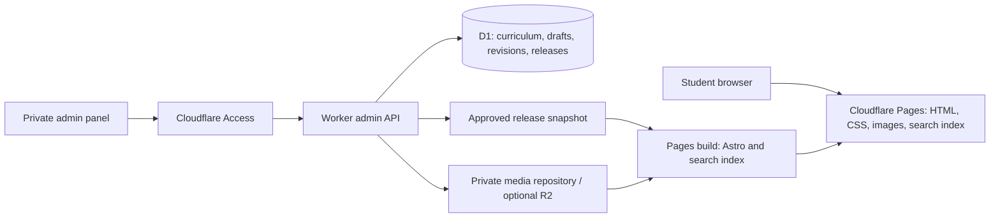

# OnlineSir.in — project plan

Prepared 10 November 2026. Status: initial local application implemented; production accounts and deployment are pending. See `docs/IMPLEMENTATION-STATUS.md` for verified functionality and remaining scope. This document retains the full target architecture.

## 1. Recommended direction

Build a free-to-read Assamese-medium learning library for Classes 5–10, with a private admin panel for managing classes, subjects, textbook editions, chapters, solutions, notes and downloadable resources.

**Recommended stack: Astro static website + Cloudflare Pages + a small Cloudflare Worker admin API + Cloudflare D1 database.** Use React only for interactive admin/editor components. Students read prebuilt HTML from the CDN, without a database query for each visit. The admin panel saves drafts to D1 and publishes approved content in batches.

Initial target: 50,000 monthly visitors with zero recurring hosting charges. Retain 100,000 monthly visitors as a future growth target. This is a capacity design target, not an unconditional promise: traffic mix, file volume, builds, service terms and future pricing matter. OnlineSir.in registration/renewal is a separate cost unless already paid. Content creation and maintenance also require time.

Launch with a strictly free-tier storage path for a modest document library. Make object storage an optional, explicitly enabled upgrade when the library outgrows that path. Do not enable paid services automatically.

## 2. Audience and curriculum

- Primary audience: Assamese-medium students in Classes 5, 6, 7, 8, 9 and 10; also parents and teachers.
- Main student task: choose class → subject → textbook → chapter → read solutions or notes.
- Assamese is the primary content/UI language. Use English aliases for discovery and subject search. English subject material can contain English text alongside Assamese explanations.
- Store curriculum authority and academic session explicitly. SCERT publishes elementary textbook lists through Class VIII; current secondary references use ASSEB Division-I, with SEBA as a familiar search alias. [SCERT 2026–27 textbook list](https://scert.assam.gov.in/portlet-sub-innerpage/textbook-from-ka-shreni-to-class-viii-2026-27-0), [ASSEB Division-I](https://site.sebaonline.org/).
- Confirm the current official textbook list for each class before entering real subjects and chapters. Mathematics, science, Assamese, English and social studies are planning categories, not a verified six-class syllabus.
- Preserve older editions rather than silently replacing their chapter numbers. Choose a current edition for navigation and label archived content clearly.
- Do not claim all textbook solutions are available until the coverage inventory is complete. Show published chapter counts and honest availability labels.

## 3. Student website

| Page | Main content and actions |
|---|---|
| Home | Logo, short Assamese introduction, prominent search, six class cards, recently updated resources |
| Class | Applicable subjects, academic session, availability counts |
| Subject/book | Textbook title, edition, ordered chapters, solution/note availability |
| Chapter | Overview, exercise navigation, full question-and-answer content, notes link, previous/next chapter |
| Notes | Headings, explanations, definitions, formulas, examples and optional PDF |
| Search | Query, class/subject/resource filters, useful empty state |
| Downloads | Only published, approved resources with format and file size |
| Saved resources | Bookmarks stored on the device; no student account required |
| About/contact | Purpose, authorship and a simple correction/contact route |
| Policies | Privacy, terms, content ownership and correction policy |
| 404 | Search and class navigation |

Chapter reading design:

- Full readable HTML, not PDF-only lessons or scanned-image-only answers.
- Breadcrumbs, class/subject/book/session labels, title and last reviewed date.
- Desktop contents sidebar; mobile collapsible contents menu.
- Stable exercise/question anchors, e.g. `#exercise-2-question-4`.
- Questions and answers visible by default; print-friendly layout.
- Mathematical notation rendered accessibly; diagrams have captions and alt text.
- Copy-link, print, bookmark and optional PDF download controls.
- No forced registration, autoplay videos or large decorative hero imagery.

Proposed URLs:

```text
/
/class-5/
/class-10/mathematics/
/class-10/mathematics/<book-slug>/<edition>/
/class-10/mathematics/<book-slug>/<edition>/<chapter-slug>/
/class-10/mathematics/<book-slug>/<edition>/<chapter-slug>/notes/
/search/
/downloads/
/about/
/contact/
admin.onlinesir.in/
```

Use stable Latin slugs with Assamese display titles. Edition-specific canonical URLs prevent conflicting versions. Add redirects when slugs change; do not change URLs just because a title spelling is corrected.

## 4. Admin panel

Navigation: Dashboard · Curriculum · Solutions · Notes · Media · Publishing · Corrections · Users · Settings · Backups.

| Area | Required features |
|---|---|
| Dashboard | Published/draft counts, coverage gaps by class/subject, pending reviews, last successful release, quota indicators |
| Curriculum | Create/edit/order classes, subjects, books, editions, chapters and exercises; archive safely |
| Content editor | Assamese Unicode text, headings, lists, tables, links, images, math, structured questions/answers, autosave |
| Upload/import | PDF and image upload; Markdown/structured JSON import; validated CSV for curriculum metadata |
| Media | Search assets, rename display labels, alt text, file sizes, usage references, replace with a new version |
| Review | Draft → review → approved → queued → live; return for correction; preview changes |
| Publish | Batch selected approved revisions, display deployment progress/errors, retry and roll back |
| SEO | Title, description, slug, canonical settings with safe defaults and redirect history |
| Corrections | Initially manual admin records from contact messages; public report form can be added later |
| Users | Owner, editor and reviewer roles; revoke access; audit important changes |
| Settings | Branding, contact details, homepage featured resources and current academic session |
| Backup | Export content/database; download media manifest; show last backup and restore procedure |

Roles: owner manages users/settings/releases; editor creates and edits drafts; reviewer approves content. Owner can also review and publish for a one-person operation. Every permission is enforced in the API.

Uploads do not automatically become educational content. Scanned PDFs remain downloads unless someone transcribes and reviews them. OCR, AI answer generation and arbitrary Word-to-web conversion are outside the initial release.

An edit includes required class, subject, textbook edition, chapter, resource type, title, body and review status. PDF is optional. Preview should show the same layout as the public page. Concurrent edits use revision checks, with a clear conflict message instead of overwriting newer work.

## 5. Architecture and database



**Use D1 for the custom admin panel.** It is a SQL database suited to structured classes, books, chapters and their relationships. Keep PDFs/images outside the database. A static site alone could use files instead of a database, but drafts, revisions and admin workflows make D1 useful here.

| Component | Proposed choice | Reason |
|---|---|---|
| Public website | Astro + TypeScript, static generation | Prebuilt readable pages with little client JavaScript |
| Styling | CSS tokens / Tailwind where useful | Consistent logo-based design and responsive layouts |
| Admin | React + accessible component primitives | Rich editing, forms, tables and media workflows |
| API | Cloudflare Worker, small HTTP router | D1 integration and limited admin traffic |
| Content | Versioned structured rich-text JSON plus sanitized rendered HTML | Safe editor output, math and future migrations |
| Database | Cloudflare D1, SQL migrations | Relationships, indexes and exports |
| Search | Build-time Pagefind index | Search without a paid server or query database |
| Authentication | Cloudflare Access with an allowlisted identity provider | Private admin; no public signup or password database |
| Source | Git repository with reproducible builds | Version history and rollback |
| Analytics | Cloudflare analytics / Search Console | Aggregate traffic and search visibility |

Astro prerenders pages by default. [Astro rendering documentation](https://docs.astro.build/en/guides/on-demand-rendering/).

Pagefind supports multilingual indexing, but Assamese stemming, spelling variants and transliteration must be tested rather than assumed. Use `lang="as"`, curated English aliases and Assamese search labels. Start with exact/prefix-oriented acceptance cases; add a small normalized title/keyword index if recall is inadequate. [Pagefind multilingual documentation](https://pagefind.app/docs/multilingual/).

Proposed data model:

| Entity | Important fields / relationships |
|---|---|
| classes | id, grade (unique 5–10), Assamese/English labels, display_order |
| subjects | id, slug, labels |
| class_subjects | class_id + subject_id, display_order; unique pair |
| textbooks | class_subject_id, title, publisher, curriculum_authority |
| editions | textbook_id, session, edition_label, source_url, is_current |
| chapters | edition_id, number/label, slug, title, display_order; edition-scoped uniqueness |
| exercises | chapter_id, label, display_order |
| resources | chapter_id, type, slug, draft_revision_id, approval state |
| resource_revisions | resource_id, schema_version, title, body_json, author_id, review notes, created_at |
| question_items | revision_id, exercise reference, number/label, question, answer, display_order |
| assets | immutable key/hash, MIME type, size, storage_provider, alt text, ownership/source |
| resource_assets | revision_id + asset_id; prevent deleting referenced media |
| releases | id, approved revision manifest, build/deployment ids, state, error, created_by |
| release_resources | release_id + resource_id + revision_id |
| admin_users | identity-provider subject, role, active; no stored passwords |
| redirects | old_path, new_path, status |
| audit_events | actor, action, entity id, time; redact secrets/content where unnecessary |
| settings / corrections | typed site configuration; correction status and affected resource |

Enable foreign keys, parameterized queries and indexes on relationship keys, edition/chapter order, slugs and status. Keep queries paginated. Store revisions separately from the live release so draft edits never change student pages.

## 6. Publishing and file upload workflow

1. Admin signs in, selects class/subject/book/chapter and writes or imports content.
2. Save drafts to D1. Validate required fields, links, math and referenced assets.
3. Upload images/PDFs to private staging storage; store only metadata in D1.
4. Preview privately, review and approve an immutable revision.
5. Publish a batch: create an immutable release manifest of approved revision IDs and asset hashes.
6. Trigger a Pages build using server-held credentials. The build fetches only that release through an authenticated, paginated export endpoint.
7. Astro renders HTML; generate the search index and sitemap from the same snapshot; validate links and output limits.
8. Deploy atomically. Mark the release live only after deployment success is confirmed. A failed build leaves the previous website live.
9. Show queued/building/live/failed status and actionable errors. Retry the same release idempotently. Rollback redeploys a known successful release and updates admin status.

Default publishing is manual batch publishing, with a target of at most 10 production batches/day. Autosaves never trigger deployments. Reserve build allowance for previews, fixes and retries. Publishing is not instantaneous; show measured deployment times after implementation.

### Strict zero-hosting-cost media path

For the initial, modest library, use a **separate private media Git repository**. The authenticated admin API writes small approved file uploads using a narrowly scoped server-side credential. Browser users never receive repository credentials. Uploads into the media repository do not automatically trigger production builds. Builds retrieve the exact approved hashes and include published assets in Pages output.

Proposed application caps: images ≤2 MB before optimization; PDFs ≤5 MB; 250 MB total current media library initially. These are our conservative operating caps, not claims about provider maximums. Validate upload throughput and Worker CPU during the prototype; split uploads into small requests where needed. Show progress, reject unsupported files and avoid buffering large encoded documents in the Worker.

Git is suitable for a small initial library, but binary history grows when files are replaced. Monitor repository size including history, avoid repeated bulk binary imports and plan migration before growth becomes difficult. Retain referenced versions through the rollback window. This path adds implementation work but avoids making metered object storage mandatory.

### Optional R2 media path

R2 is the cleaner long-term destination for a large PDF/image library. Standard storage includes 10 GB-month, 1 million Class A operations and 10 million Class B operations per month; internet egress has no charge. Usage above included quotas is billable, and setup requires an R2 subscription checkout. Therefore R2 is **not** the default for an absolute zero-charge requirement. [R2 pricing](https://developers.cloudflare.com/r2/pricing/), [R2 setup](https://developers.cloudflare.com/r2/get-started/).

When enabled, use private draft objects, authorized upload URLs and immutable public asset paths after approval. Restrict CORS and file types; serve public objects from a suitable custom domain. Budget alerts are not a hard spending cap. Downloads can create operations charges even when bandwidth is free.

## 7. Capacity and cost model

Assumptions for planning, to validate using actual analytics:

- Initial target: 50,000 monthly unique visitors × 5 pageviews per visitor = 250,000 pageviews/month.
- Over 30 days: about 8,333 pageviews/day average; test a 10× peak day and short bursts separately.
- At 300 KB transferred per pageview: approximately 75 GB/month before downloads and repeat-cache effects.
- If 10,000 visitors download a 2 MB PDF: another 20 GB/month. Text notes are the primary format; PDFs are optional.
- Future growth target: 100,000 monthly visitors. Under the same assumptions, pageviews and transfer estimates double; reassess actual usage before expansion.
- HTML, CSS, images and search requests use static delivery. Public reading and searching should make zero D1 calls.
- Example editorial load: 5 admins × 200 API actions/day = 1,000 API calls/day, plus uploads and publishing; measure row scans and export volume separately.

Cloudflare documents free, unlimited static asset requests on Pages; Pages Functions share Workers limits. Keep public paths outside function routing. [Pages pricing](https://developers.cloudflare.com/pages/functions/pricing/).

| Service | Verified free allowance / constraint | Project response |
|---|---|---|
| Pages builds | 500/month; one concurrent build; 20-minute timeout | Batch releases and reserve capacity |
| Pages output | 20,000 files/site; 25 MiB per file | Count HTML, assets AND search-index chunks before publishing |
| Workers Free | 100,000 requests/day; 10 ms CPU/invocation | Admin-only API, small requests, no synchronous heavy conversion |
| D1 | 5 million rows read/day, 100,000 rows written/day, 5 GB account storage | Indexed admin queries and static student pages |
| D1 individual DB | 500 MB on Free | Start with one database and monitor revisions before 350 MB |
| Domain | Separate registration/renewal | Use existing OnlineSir.in or a provider subdomain initially |

Sources: [Pages limits](https://developers.cloudflare.com/pages/platform/limits/), [Workers limits](https://developers.cloudflare.com/workers/platform/limits/), [D1 pricing](https://developers.cloudflare.com/d1/platform/pricing/), [D1 limits](https://developers.cloudflare.com/d1/platform/limits/).

These are shared account quotas where applicable. Verify unused allowance in the actual account before deployment. Keep Cloudflare on Free; hitting a hard quota can interrupt admin operations rather than automatically guarantee continuity. The last successful static release should remain readable during admin/database failures.

Alert/review targets: 70% of database/storage/API quotas, 350 builds/month, 14,000 generated files, or sustained builds over 10 minutes. First prune safe expired revisions, reduce redundant media and batch publishes. Review paid options only if needed and explicitly authorized.

Why not Supabase as the default? It is a good option for richer user accounts and PostgreSQL applications, but this project chiefly needs static educational pages and a small editorial database. Supabase Free currently includes a 500 MB database and 5 GB standard egress, making uncached public content delivery an additional quota concern. It remains viable behind the same static publishing architecture. [Supabase pricing](https://supabase.com/pricing).

## 8. Brand and visual design

Use the supplied logo and favicon. Original copies are preserved under `assets/brand/`.

Pixel sampling of opaque saturated logo pixels, quantized to 8-value RGB buckets, found dominant navy `#002860` and green `#008858`. These are representative palette anchors, not a claim that every logo pixel has an identical colour.

| Token | Value | Use |
|---|---|---|
| Primary | #002860 | Header text, headings, navigation, primary buttons |
| Brand green | #008858 | Brand accents, subject highlights |
| Action green | #007A50 | Green buttons with white text |
| Background | #F5F8FC | Overall page background |
| Surface | #FFFFFF | Reading surfaces and cards |
| Text | #16263D | Body copy |
| Muted text | #526175 | Secondary copy |
| Border | #DCE5EF | Card/input separation |
| Soft green | #E8F5EF | Gentle highlights |

Adopt a clean library layout with generous reading space, restrained shadows and modest corner rounding. The UI/UX skill's minimal design direction fits reference reading; logo colours and Assamese-capable typography override its generic palette/font suggestions.

Use a candidate Assamese-capable family such as Noto Sans Bengali and verify actual Assamese glyphs (ৰ, ৱ), conjuncts, numerals and mixed math before settling the font. Self-host licensed WOFF2 files and preserve the required character coverage. Use a system sans-serif fallback. Body text approximately 18px on reading pages, line-height 1.75–1.9; headings have a clear scale. Avoid truncating chapter titles.

Mobile first: 44px minimum touch targets, visible keyboard focus, labelled inputs, skip link, sufficient contrast, reduced-motion support, no horizontal page scrolling. Test 360px, 390px, 768px, 1024px and 1440px widths. Tables and equations may scroll within labelled containers.

Homepage structure: compact header → short purpose statement/search → six class cards → recently published chapters → brief help/about → footer. No invented student counts or testimonials.

## 9. Content, discoverability and quality

- Curriculum inventory records every required book, edition, chapter and resource; completion is computed from reviewed published coverage.
- Content workflow: source identification → original explanation/solution → subject review → Assamese proofreading → publish.
- Publish original notes and solutions; track source/permission for uploaded materials and link to official textbook sources where appropriate.
- Unique titles and descriptions; canonical links; breadcrumb structured data; sitemap and robots controls; useful internal links.
- Only published resources enter the public search index and sitemap. Protect drafts/previews; use noindex as an additional control, not authentication.
- Native Assamese speaker reviews interface copy, text rendering, search queries and sample lessons before launch.
- Target LCP ≤2.5s, INP ≤200ms and CLS ≤0.1 on representative mobile devices. These are validation goals, not measured results.
- Defer video embeds until clicked. Do not host video files in the initial infrastructure.

## 10. Security, backups and operations

- Allowlist administrator identities; require MFA through the identity provider where available.
- Protect admin UI AND API. Validate Access JWT signature, issuer, audience and expiry; do not trust an email header alone. Disable unprotected alternate API hostnames.
- Enforce authorization on every mutation; validate origin/CSRF controls, input sizes, MIME signatures and safe filenames; rate-limit upload/publish endpoints.
- Sanitize rich content and external URLs; prohibit executable uploads and arbitrary MDX/scripts. Serve untrusted documents with safe content headers.
- Store provider/build credentials only as server/build secrets. Preview responses are private and never publicly cached.
- Record audit events for edits, permissions, deletion and releases. Soft-delete referenced curriculum/content; require explicit confirmation before permanent deletion.
- Export D1 and release manifests daily to an independent backup destination; initial manual download is acceptable during setup, then automate within free quotas. Keep weekly off-provider copies of media and source. A database export alone does not back up uploaded files.
- Target recovery point: 24 hours; recovery time: one working day. Test restore before launch and quarterly thereafter. These are operating targets pending measured recovery tests.
- Monitor failures, quota trends, broken links, build health and missing media. Monthly maintenance checks dependency updates and curriculum notices.
- Avoid student accounts and collecting personal student information in the first version. Add a public correction form only with an explicit data retention and abuse-control design.

## 11. Implementation sequence and completion gates

| Phase | Deliverables | Completion gate |
|---|---|---|
| 1. Foundation | Repo setup, tokens, optimized logo assets, route skeleton, curriculum import format | Logo/Assamese sample readable on mobile; build reproducible |
| 2. Public library | Home, class, book, chapter, notes, search and print layouts | Complete sample journey across at least two classes |
| 3. Admin/data | D1 migrations, identity, role checks, editor, uploads, revisions | Owner can create a class/book/chapter and save a private draft |
| 4. Publishing | Release snapshots, build trigger, status, retry, rollback, search/sitemap generation | Draft invisible publicly; approved batch deploys; failure preserves live site |
| 5. Content pilot | Reviewed pilot chapters, PDF examples, current edition inventory | Subject and Assamese review passed; uploads/downloads verified |
| 6. Launch | Domain/HTTPS, SEO setup, backups, accessibility/performance checks | Restore and rollback demonstrated; no leaked secrets/drafts |
| 7. Expansion | Add all Classes 5–10 books and reviewed solutions in measured batches | Coverage inventory demonstrates completeness for the declared edition |

Suggested first release: navigation for all six classes with a clearly labelled pilot of reviewed material. Prioritize Class 10 Mathematics and Science if the owner has that content ready; final order should follow available reviewed notes. Never fill missing real lessons with fabricated textbook solutions.

Software effort planning range: roughly 4–6 focused development weeks for a dependable custom CMS and public site, subject to prototype findings and review availability. Producing all six classes' educational material is a separate editorial programme; estimate it after counting chapters and available notes.

Verification must cover: permissions and direct API access; draft isolation; upload restrictions; revision conflicts; failed and repeated publish attempts; rollback; Unicode search and printing; broken links; missing media; output-file counts; quota estimates; backup restore. Use targeted automated integration tests for these flows and manual mobile/accessibility checks.

## 12. Inputs needed before production setup

Planning proceeds with these defaults: public Assamese-first site, no student signup, one owner initially, manual batch releases, strict free-tier storage mode.

Before connecting production services, obtain:

1. Domain ownership/DNS access and existing Cloudflare/Git provider account details through secure authorization.
2. Owner identity/email and any editorial team roles.
3. Current textbook inventory/editions and an initial set of approved notes/solutions.
4. Confirmation that uploaded source material may be published.
5. Contact/about details and actual recovery/backup destination.

No account creation, subscription, domain changes or deployment occurred as part of this planning task.
